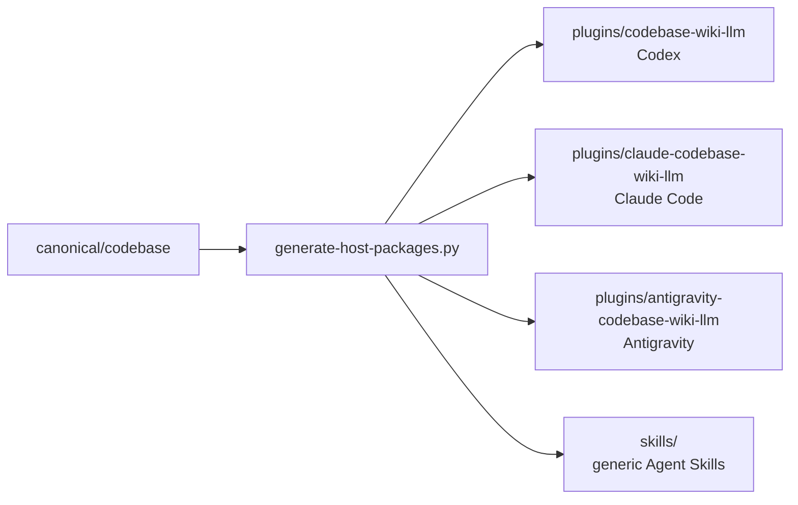

# Architecture

## Sources and generated packages

Behaviour lives once, in `canonical/codebase/`: the maintainer knowledge
(`maintainer.md`), the default `SCHEMA.md` (`default-schema.md`), the four
workflows (`workflows/wiki-*.md`), the always-loaded rule
(`rules/wiki-context.md`), templates (`references/`) and scripts (`scripts/`).
`python3 scripts/generate-host-packages.py` writes one package per host; the
files under `plugins/`, `skills/`, `.claude-plugin/` and `.agents/` are
generated and never edited by hand ([development guide](../docs/development.md)).

| Host | Package | Triggers |
| --- | --- | --- |
| Codex | `plugins/codebase-wiki-llm` | one skill per operation, hooks |
| Claude Code | `plugins/claude-codebase-wiki-llm` | slash commands, skills, hooks |
| Antigravity | `plugins/antigravity-codebase-wiki-llm` | skills, always-on rule, PreInvocation hook |

## Two version numbers

`canonical/codebase/VERSION` is the plugin release; `FORMAT_VERSION` in
`validate-wiki.py` is the wiki format it checks. Several releases share one
format ([decision 0001](project/decisions/0001-format-version-separate-from-release.md)).

## Validator

`canonical/codebase/scripts/validate-wiki.py` is read-only, needs Python 3.10+
and nothing else, and ships byte-identical in every package. Exit 0 valid,
1 findings, 2 invocation error; `upgrade:` and `info:` lines never change the
exit code. `--json` prints one document for tools such as the desktop app
([decision 0003](project/decisions/0003-validator-json-for-tools.md)).

## Hooks

- `resolve-wiki-root.sh` (SessionStart): finds the wiki root (`.wikidir` or `wiki/`).
- `remind-wiki-sync.sh` (UserPromptSubmit; PreInvocation on Antigravity):
  notes code changed since the session started; reads the host's JSON payload
  with a small awk parser, no Python needed.
- `check-private-terms.sh` (pre-commit, optional): blocks commits holding a
  term from `<wiki-root>/.private-terms`; `=term` matches a whole word.

## Invariants

- Edit `canonical/`, then regenerate; `scripts/check-generated.sh` fails on drift.
- Canonical Markdown never hard-codes `wiki/`; it writes `<wiki-root>/`.
- The validator never reads `.private-terms` contents and never writes files.

## Verification

`bash scripts/run-tests.sh` runs every check: generated-file drift, generators,
wiki-root resolver, handoff and wiki validators, private terms, reminder hook,
hook wiring.
